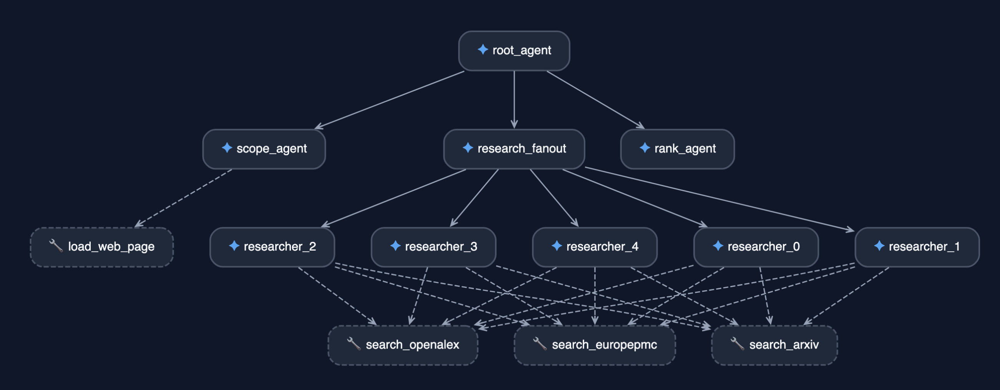

# Literature Reviewer Agent

[](https://literature-reviewer-4055136070.us-central1.run.app/reviewer)

Literature review is often a daunting task. This concierge agent runs as a hosted web app on **Google Cloud Run** — point it at your field of interest (a CV, a seed paper, or a few keywords) and it returns a single ranked, structured review of the last ~12 months of papers in that field. It works for any field — the pipeline adapts to whatever you point it at. The public server generates reviews on **your own API key**, used per-request and never stored.

**Live server:** https://literature-reviewer-4055136070.us-central1.run.app/reviewer

## Example output

The server renders your review as a single self-contained page — an interactive queue you can tag, filter, and export notes from (state persists in `localStorage`). It's served same-origin at `/reviewer`; because it makes no external calls once loaded, you can also save the page ([`literature-reviewer.html`](literature-reviewer.html)) and reopen it offline.

**Overall layout** — ranked queue, sidebar, interests panel, and per-paper cards:


**Paper card (detail)** — Aim → Main approach → Evaluation → Results (with quantitative task/data/metric/result bullets) → Limitation:


See [`paper-review-SPEC.md`](paper-review-SPEC.md) for the complete specification of this output.

## Run or deploy your own server

**Using the hosted app needs no setup** — open the live URL and paste your own model API key (Gemini, Anthropic, or OpenAI) in the interests panel; it is used per-request and never stored. Reviews are always generated on the caller's key, so the server holds no model credentials of its own.

To run your **own copy**, the server needs **Google Cloud credentials** — it calls `google.auth.default()` and initializes Cloud Logging at startup ([app/fast_api_app.py](app/fast_api_app.py)). Copy [`.env.example`](.env.example) to `.env`, then:

1. `gcloud auth application-default login`
2. set `GOOGLE_CLOUD_PROJECT` (and `GOOGLE_CLOUD_LOCATION=global`) in `.env`

No server-side model key is required for the public review endpoints. *(Only if you enable the ADK agent API — `ENABLE_AGENT_API=true` — do you also need a model backend: Vertex AI by default, or `GEMINI_API_KEY`, or `ANTHROPIC_API_KEY` + `REVIEW_MODEL=anthropic/claude-sonnet-5`.)* Optional: `OPENALEX_MAILTO` for the OpenAlex polite pool.

### With Docker (recommended — reproducible)

The repo ships a [`Dockerfile`](Dockerfile) pinning Python 3.12 + `uv` on port 8080 — no local Python/uv install needed. Docker packages the code and dependencies, but not your Google credentials, so mount them in:

```bash
docker build -t literature-reviewer .
docker run --env-file .env -p 8080:8080 \
  -v ~/.config/gcloud/application_default_credentials.json:/adc.json:ro \
  -e GOOGLE_APPLICATION_CREDENTIALS=/adc.json \
  literature-reviewer
# → open http://localhost:8080/reviewer
```

### Without Docker

```bash
uv sync                                                          # install deps (Python 3.11–3.13)
uv run uvicorn app.fast_api_app:app --host 0.0.0.0 --port 8080
```

### Deploy to Cloud Run

On Cloud Run the credentials come from the service account automatically. `agents-cli deploy` (from the [Agents CLI](https://github.com/google/agents-cli): `uv tool install google-agents-cli`) builds the same container and ships it to **Google Cloud Run**. Infrastructure is Terraform under [`deployment/terraform/`](deployment/terraform/). See [`paper-review-SPEC.md`](paper-review-SPEC.md) for the full specification of the generated review app.

## LangChain variant (`lc_app/`)

The same pipeline and output, built on **LangGraph** instead of ADK, with paper search served by a local, keyless **MCP server** that pools five sources:

| Source | What it adds |
|---|---|
| OpenAlex | broadest coverage, citation counts + FWCI |
| Europe PMC | PubMed/PMC journal articles with abstracts |
| PubMed (E-utilities) | MEDLINE metadata, PubMed query syntax |
| arXiv | cs / q-bio / stat / physics preprints |
| bioRxiv / medRxiv | keyword search via Europe PMC's preprint index; DOI lookups (incl. "published as") via api.biorxiv.org |

`search_papers` queries them all in parallel and merges hits that share a DOI or title, so a preprint and its journal version count as one paper.

```bash
uv sync --extra langchain
uv run --extra langchain review-lc "recent single-cell foundation model papers" --open
uv run --extra langchain review-lc --cv https://example.edu/~me --topics "a; b" --model openai:gpt-5
```

- **Model:** `LC_REVIEW_MODEL` / `--model`, an `init_chat_model` id (default `anthropic:claude-sonnet-5-5`).
- **Focus:** `LC_REVIEW_FOCUS` / `--focus` sets a standing lens applied to scope, research and rank. The default is frontier ML for genomics/biology (new architectures, bio foundation models, scaling, rigorous benchmarks). `--no-focus` makes it field-general like the ADK app.
- **Pipeline:** scope → `Send` fan-out of one `create_agent` researcher per cluster over the MCP tools → structured-output ranker → the same `app/render.py` HTML.
- **Credibility weighting:** author credibility is the primary signal (senior-author h-index first, then first-author h-index, citations, FWCI); peer-reviewed venue is a secondary tie-breaker over arXiv/bioRxiv preprints, roughly half the weight. The ranker sees evidence, not names: venue type, arXiv `journal_ref`/"accepted at" notes, first/senior-author h-index (OpenAlex), citations and FWCI. Venue and preprint status are copied from the tool output, so the model can't upgrade a preprint.
- **Full text, for the final selection only:** after ranking (which stays abstract-based), the selected papers are re-analyzed from full text: arXiv HTML/PDF, PMC (NCBI and Europe PMC, incl. author manuscripts), and legal open copies found by Unpaywall (`UNPAYWALL_EMAIL`); bioRxiv optionally via its official requester-pays S3 buckets (`LC_BIORXIV_S3=1` + AWS credentials). Result bullets quoting numbers absent from the text are dropped; papers without open full text are labeled "Abstract only".
- **Paperpile (beta MCP, optional):** with `PAPERPILE_API_KEY` in `.env`, reviewed papers already in your library get an "In your Paperpile" badge. `--paperpile-profile [FOLDER]` adds up to 100 titles from your library (or one folder/label) to the request as an interest profile. `--save-to-paperpile [LABEL]` saves the reviewed papers under a label (default `review-lc`); existing copies only gain the label, and nothing is deleted or rewritten. `--include-paperpile "to read"` adds every paper in that folder/label to the review, analyzed like manually added papers and shown in purple with a "Paperpile: to read" badge (items without a DOI, arXiv id or paper URL, like tool web pages, are skipped). `--added-since 6m` (or a date) keeps only papers added to the library since then; Paperpile doesn't record when a label was applied. `--only-added` skips the literature search and reviews just the added papers. `--no-paperpile` skips Paperpile entirely. Check the connection with `python -m lc_app.paperpile`.
- **Integrity in code:** a researcher's or ranker's paper is kept only if an MCP tool actually returned it during the run, and its URL/DOI/citation count are copied from the tool output.
- **Use the MCP server elsewhere:** `claude mcp add paper-sources -- uv run --directory "$PWD" --extra langchain paper-sources-mcp`. Optional env: `OPENALEX_API_KEY` (recommended: keyless OpenAlex requests share a ~100-search/day per-IP budget), `NCBI_API_KEY`.

## Model-agnostic by design

Model choice is a **config knob** (`REVIEW_MODEL`), never chat input. A bare Gemini id runs ADK-native; a LiteLLM `provider/model` id (e.g. `anthropic/claude-sonnet-5`, `openai/gpt-4o`) routes through LiteLLM. The hosted BYO-key server supports Gemini, Anthropic, and OpenAI behind one `call_llm`, with loose/repairing JSON parsing so a truncated or fenced response still yields a valid review. Because search runs on keyless tools rather than provider-specific grounding, swapping models changes nothing downstream.

## Agent workflow



Generated with `agents-cli playground`. `root-agent` sequentially runs `scope_agent`, `research_fanout`, and `rank_agent`.

## Contributing

Contributions are welcome — bug reports, features, documentation, and new-domain
profiles alike.

- **Issues** — report bugs or request features via [GitHub Issues](https://github.com/jykr/literature_reviewer_agent/issues). Include repro steps: inputs, model, and expected vs. actual behavior.
- **Pull requests** — fork, branch, and open a PR. Keep changes focused, run `uv run pytest tests/unit tests/integration` before submitting, and explain the rationale alongside the change.
- **Search sources** — the app works for any field out of the box; adding or tuning scholarly search adapters ([app/search_tools.py](app/search_tools.py)) to improve coverage in a given field is among the most useful contributions.
- **Ideas & feedback** — open a [Discussion](https://github.com/jykr/literature_reviewer_agent/discussions) or an issue to propose a direction before implementing.

By contributing, you agree your work is licensed under the same terms as this project.
